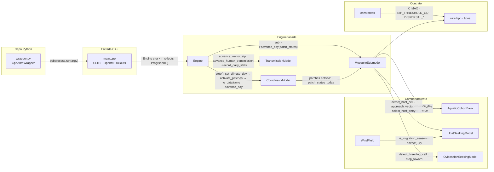
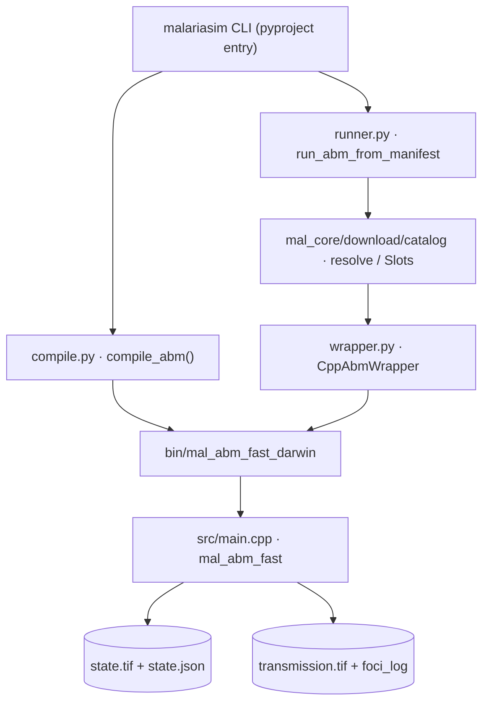

# 00 · Índice — Motor ABM (`mal-core/src/mal_core/abm/`)

Nota-raíz del vault MalariaSentinel. Todo lo demás cuelga de aquí.

## Codificación de relaciones

- Tablas `Conexiones` = call graph **verificado** (src real + índice codebase-memory, 130 aristas CALLS).
- Cada nota lleva edges tipado en frontmatter (`calls:` / `called_by:` / `owns:` / `reads:` / `writes:`) con wikilinks → navegable en Obsidian Graph View y clickable en texto.
- Convención completa y cómo extender: [[90-convenciones]].

## Navegación

1. **Vista macro:** [[10-sistema]] — capas Python → CLI → Engine → submodelos → COG/JSON. Dependencias (binario/datos/flags): [[dependency-flow-diagram]].
2. **Vista temporal:** [[15-bucle-diario]] — el pulso del sistema, `Engine::step()`.
3. **Clase por clase:** notas [[20-main-cli]] [[21-engine]] [[22-coordinator]] [[23-mosquito-submodel]] [[24-aquatic-cohort-bank]] [[25-host-seeking]] [[26-oviposition-seeking]] [[27-transmission]] [[28-wind-field]].
4. **Contrato de datos:** [[30-tipos-datos]] · [[31-constantes]].
5. **Capa Python:** [[40-wrapper]].
6. **Canvas nativo:** [[90-convenciones]] (el canvas `abm-architecture.canvas` se abre como canvas, no como texto).

## Diagrama maestro

## Enrutado build + runtime

## Orden de lectura recomendado

[[10-sistema]] · [[15-bucle-diario]] · [[dependency-flow-diagram]] · [[20-main-cli]] · [[21-engine]] · [[22-coordinator]] · [[23-mosquito-submodel]] · [[24-aquatic-cohort-bank]] · [[25-host-seeking]] · [[26-oviposition-seeking]] · [[27-transmission]] · [[28-wind-field]] · [[30-tipos-datos]] · [[31-constantes]] · [[40-wrapper]] · [[90-convenciones]] · [[91-plugins-setup]]

## up

up:: [[10-sistema]]