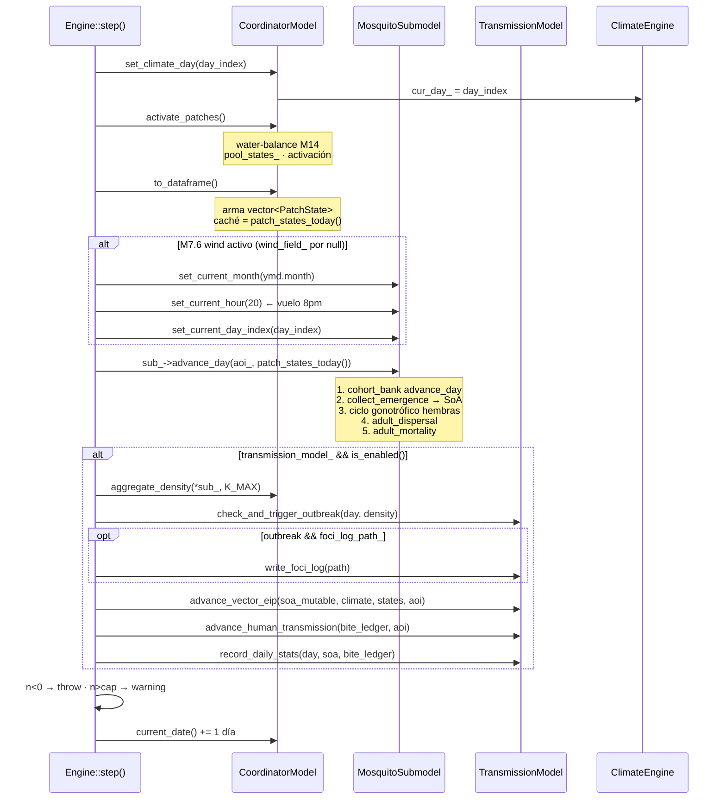

up:: [[10-sistema]]

<!-- bc:auto:start -->
```breadcrumbs
type: mermaid
depth: [0, 1]
sort: field
show-attributes: [field]
mermaid-direction: LR
mermaid-arrow: true
```

> [!info] Conexiones exactas del grafo
> **Nodo actual · nota: 15 bucle diario**
> *Mantenida manualmente — fuente: cpp real + índice codebase (“no es suposición”).*
| método llamador | llamada → destino | en archivo | detalle / firma |
|---|---|---|---|
| [[21-engine]] | [[22-coordinator]] | coordinator.cpp | steps 1, 2, 3, 6, 12 |
| [[21-engine]] | [[23-mosquito-submodel]] | mosquito_submodel.cpp:466 | step 5 |
| [[21-engine]] | [[27-transmission]] | transmission.cpp | steps 7-10 |
| `step()` | `cells_per_side()` | wire.hpp (AOI) | cap divergence |
| `step()` | `K_MAX` | [[31-constantes]] | en cap y aggregate |

<!-- bc:auto:end -->


# 15 · Bucle diario — `Engine::step()` (el corazón)

**Rol.** Un día completo de simulación en orden fijo, con `wind guard` intermedio y divergence checks al final. Todo lo demás cuelga de esta función.

## Secuencia exacta (engine.cpp:537-597)



## Código al detalle

| Paso | Línea | Llamada | Por qué |
|---|---|---|---|
| 1 | 540 | `coord_->set_climate_day(day_index)` | hora cero del clima: `cur_day_` del ClimateEngine fija bandas del día |
| 2 | 542 | `coord_->activate_patches()` | charcos activan/desactivan por agua: `W[t+1]=max(0, W+rain−evap)` [[31-constantes]] |
| 3 | 544 | `coord_->to_dataframe()` | materializa `vector<PatchState>`: estado por parche + rain_7d_buffer |
| 4 | 550-555 | `sub_->set_current_month/hour/day_index` | solo si `wind_field_` no-null; hora 20h = inicio vuelo típico |
| 5 | 556 | `sub_->advance_day(aoi_, states)` | **las 5 fases del submodelo**, ver [[23-mosquito-submodel]] |
| 6 | 560 | `coord_->aggregate_density(*sub_, K_MAX)` | densidad actual → grilla (H,W) para detección de brote |
| 7 | 561 | `check_and_trigger_outbreak(...)` | si hot-spot denso → dispara foco SEIR |
| 8 | 568 | `advance_vector_eip(soa_mutable(), ...)` | EIP(GDD) de cada vector según temp del día |
| 9 | 569 | `advance_human_transmission(bite_ledger(), aoi_)` | bites del ledger → infección humana → human SEIR |
| 10 | 571 | `record_daily_stats(...)` | snapshot métricas del día (prevalencia, EIR) |
| 11 | 576-591 | divergence | `n<0` = throw; `n>cap` = warning (cap = celda² × K_MAX×10) |
| 12 | 595 | `coord_->current_date() += 1 día` | fecha se guarda en coordinator, no en Engine |

## Conexiones

| Desde | Llama a | En | Detalle |
|---|---|---|---|
| [[21-engine]] | [[22-coordinator]] | coordinator.cpp | steps 1, 2, 3, 6, 12 |
| [[21-engine]] | [[23-mosquito-submodel]] | mosquito_submodel.cpp:466 | step 5 |
| [[21-engine]] | [[27-transmission]] | transmission.cpp | steps 7-10 |
| `step()` | `cells_per_side()` | wire.hpp (AOI) | cap divergence |
| `step()` | `K_MAX` | [[31-constantes]] | en cap y aggregate |

## Orden no negociable

Emergencia → ciclo de sangre → oviposición → dispersión → muerte: si se invierte el orden, los conteos📇 de cohortes y de muertes cambian (el test de ciclo de vida lo asegura). Cualquier nueva fase se inserta **entre** 5 y 6 en `step()`, nunca dentro del submodelo.

up:: [[10-sistema]] · related:: [[23-mosquito-submodel]] · [[27-transmission]]