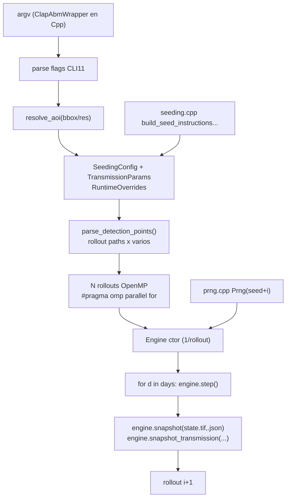

up:: [[10-sistema]]

<!-- bc:auto:start -->
```breadcrumbs
type: mermaid
depth: [0, 1]
sort: field
show-attributes: [field]
mermaid-direction: LR
mermaid-arrow: true
```

> [!info] Conexiones exactas del grafo
> **Nodo actual · nota: 20 main cli**
> *Mantenida manualmente — fuente: cpp real + índice codebase (“no es suposición”).*
| método llamador | llamada → destino | en archivo | detalle / firma |
|---|---|---|---|
| `main()` | `resolve_aoi` | main.cpp (anon ns) | bbox → AOI con `cells_per_side()` |
| `main()` | `parse_detection_points` | main.cpp | Fleet: modo detección vs uniforme |
| `main()` | `write_transmission_log` | transmission_output.cpp | log de focos por rollout |
| Engine ctor | construcción completa | [[21-engine]] | 1 objeto por rollout |
| `main()` | `SeedingPatch` struct | engine.hpp | debug patch-pin para observación** |

<!-- bc:auto:end -->


# 20 · main.cpp — CLI + bucle de rollouts

**Rol.** Punto de entrada del binario `mal_abm_fast`. Parsea 50+ flags con CLI11, resuelve el AOI, arma la config, y lanza el bucle paralelo de rollouts. No modela nada: solo *construya* y *dirija*.

## Estructura



## Fases de `main()`

| Fase | Función | De dónde viene |
|---|---|---|
| 1 · config | `CLI::App`, grupos Spatial/Input/Seeding/Dynamics/Transmission/Output | definición inline en main.cpp |
| 2 · AOI | `resolve_aoi()` | namespace anónimo de main.cpp |
| 3 · detecciones | `parse_detection_points()` | JSON de puntos con conteo → SeedInstruction |
| 4 · paths | `rollout_output_path / day_path / transmission_*` | patrón `<out>/<prefix>_roll<i>_day<d>.tif` |
| 5 · rollouts | `Prng(seed + i)` por rollout, Engine nuevo por rollout | reproducible entre rollouts |
| 6 · loop | `for (day) engine.step()` | abierto `files` claves day paths en JSON de salida |
| 7 · snapshot | `engine.snapshot Trans...` | helpers [[21-engine]] snapshot ×2 |

## Conexiones

| Desde | Llama a | En | Detalle |
|---|---|---|---|
| `main()` | `resolve_aoi` | main.cpp (anon ns) | bbox → AOI con `cells_per_side()` |
| `main()` | `parse_detection_points` | main.cpp | Fleet: modo detección vs uniforme |
| `main()` | `write_transmission_log` | transmission_output.cpp | log de focos por rollout |
| Engine ctor | construcción completa | [[21-engine]] | 1 objeto por rollout |
| `main()` | `SeedingPatch` struct | engine.hpp | debug patch-pin para observación**

## Nota clave

Un Engine es barato por rollout porque el clima se comparte vía `shared_ptr<ClimateEngine>` (2° ctor), no dublicado por rollout. La **memoria del clima** baja de `O(n_rollouts × days)` a `O(days)`. Véase [[21-engine]].

up:: [[10-sistema]] · related:: [[21-engine]] · [[40-wrapper]]