up:: [[00-INDEX]]

<!-- bc:auto:start -->
```breadcrumbs
type: mermaid
depth: [0, 1]
sort: field
show-attributes: [field]
mermaid-direction: LR
mermaid-arrow: true
```

> [!info] Conexiones exactas del grafo
> **Nodo actual · nota: 21 engine**
> *Mantenida manualmente — fuente: cpp real + índice codebase (“no es suposición”).*
| método llamador | llamada → destino | en archivo | detalle / firma |
|---|---|---|---|
| Engine ctor | `peek_state`, `uniform_double` | prng.cpp | RNG global del rollout (seeding intra-ctor) |
| Engine ctor | `set_K_eff_view` | aquatic_cohort_bank.hpp | conecta la grilla K_eff del coordinator al banco de cohortes |
| Engine ctor | `set_species` | mosquito_submodel.hpp | SpeciesParams → submodelo |
| `step()` | ver secuencia completa |  | [[15-bucle-diario]] |
| `snapshot()` | `write_diagnostics` | aquatic_cohort_bank.cpp | diagnóstico de cohortes al guardar |
| `snapshot*()` | `cells_per_side` | wire.hpp | dims de grilla COG |
| `residential_*()` | `host_landscape_->cells_` | host_landscape | proyección a grilla para snapshot |

<!-- bc:auto:end -->


# 21 · Engine — la fachada

**Rol.** Dueño de todos los submodelos (`unique_ptr`/raw pointers no-owning según el caso). Su único método de trabajo es `step()` ([[15-bucle-diario]]), y expone snapshots a disco. Es la única clase que *ve todo el tablero*.

## Composición (campos del header, engine.hpp:179-206)

```mermaid
flowchart TD
  E[Engine]
  E -->|unique_ptr| CL[ClimateEngine<br/>climate.hpp]
  E -->|unique_ptr| HA[HabitatEngine<br/>habitat_engine.hpp]
  E -->|unique_ptr| CO[CoordinatorModel<br/>coordinator.hpp]
  E -->|unique_ptr| SU[MosquitoSubmodel<br/>mosquito_submodel.hpp]
  E -->|unique_ptr| TM[TransmissionModel<br/>transmission.hpp]
  E -->|raw ptr · no-owning| HL[HostLandscape]
  E -->|raw ptr · no-owning| MS[MobilitySchedule]
  E -->|raw ptr · no-owning| HS[HostSeekingModel]
  E -->|raw ptr · no-owning| EC[EffectiveHostLandscape]
  E -->|raw ptr · no-owning| WF[WindField]
  E -->|valor| SP[SpeciesParams]
  E -->|valor| TP[TransmissionParams]
  E -->|chrono| CD[current_date_ / start_date_]
```



*Regla de propiedad: campos con `_` finales que terminan en `unique_ptr` son dueños; los que apuntan a datos compartidos (`host_landscape_`, `mobility_schedule_`, `wind_field_`...) son punteros no-owning — otro objeto posee el dato; Engine solo lee.*

## Constructores (2)

| Ctor | Firma | Uso |
|---|---|---|
| principal | `Engine(AOI, clima, habitat, host_land, mobility, host_seeking, wind, overrides, seeding…)` | main.cpp lo usa una vez por rollout |
| clima compartido | mismo pero `std::shared_ptr<ClimateEngine>` | multi-rollout: 1 clima N engines ([[20-main-cli]]) |

## Métodos públicos

| Método | Firma | Qué hace |
|---|---|---|
| `step()` | `void step()` | un día completo, [[15-bucle-diario]] |
| `snapshot()` | `(path, y, m, seed, n_rollouts, rollout_i)` | COG densidad+suiza + JSON sidecar |
| `snapshot_transmission()` | `(path, ...)` | COG humano SEIR por celda + sidecar |
| `total_agents()` | `int64_t` | `sub_->soa().n_alive` |
| `residential_human/livestock_grid()` | `vector<float>` | grillas residenciales para snapshot |
| `set_*` | debug · foci_log · max_population | hooks de main.cpp |

## Conexiones

| Desde (método) | Llama a | En | Detalle |
|---|---|---|---|
| Engine ctor | `peek_state`, `uniform_double` | prng.cpp | RNG global del rollout (seeding intra-ctor) |
| Engine ctor | `set_K_eff_view` | aquatic_cohort_bank.hpp | conecta la grilla K_eff del coordinator al banco de cohortes |
| Engine ctor | `set_species` | mosquito_submodel.hpp | SpeciesParams → submodelo |
| `step()` | ver secuencia completa | | [[15-bucle-diario]] |
| `snapshot()` | `write_diagnostics` | aquatic_cohort_bank.cpp | diagnóstico de cohortes al guardar |
| `snapshot*()` | `cells_per_side` | wire.hpp | dims de grilla COG |
| `residential_*()` | `host_landscape_->cells_` | host_landscape | proyección a grilla para snapshot |

up:: [[00-INDEX]] · related:: [[15-bucle-diario]] · [[20-main-cli]]