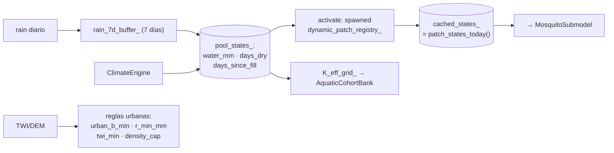

up:: [[21-engine]]

<!-- bc:auto:start -->
```breadcrumbs
type: mermaid
fields: [calls, called_by, owns]
depth: 1
mermaid-direction: LR
show-attributes: true
```

> [!info] Conexiones exactas del grafo
> **Nodo actual · nota: 22 coordinator**
> *Mantenida manualmente — fuente: cpp real + índice codebase (“no es suposición”).*
| método llamador | llamada → destino | en archivo | detalle / firma |
|---|---|---|---|
| ctor `CoordinatorModel` | `patches()` | habitat_engine.hpp | lista base de parches estáticos |
| `to_dataframe` | `patches()` \ | habitat · coordinator.cpp | parches + lluvia 7 días |
| `build_seed_instructions` | `patches()` | habitat | para sembrar en parche más cercano |
| `build_uniform_seed_instructions` | `to_dataframe` \ `patches()` | coordinator.cpp | modo sin detección |
| `aggregate_density` | `patches()` \ `density_by_patch()` | habitat · mosquito_submodel.cpp | SoA → parche → celda |
| `suitability_grid` | `adult_density_by_cell()` | mosquito_submodel.cpp | grilla de aptitud |
| `write_state_cog` | `cells_per_side` | [[31-constantes]] (wire.hpp) | dimensiones h·w del COG |

<!-- bc:auto:end -->


# 22 · CoordinatorModel — parches, clima y agregación

**Rol.** Traduce clima+terreno a **estado diario por parche** (`vector<PatchState>`) que todo el resto consume. También agrega densidad de adultos por celda y escribe los COGs de estado.

## Métodos clave

| Método | Qué hace | Usa |
|---|---|---|
| `set_climate_day(i)` | reloj del clima a día i | `climate_->cur_day_` |
| `activate_patches()` | hidrología M14 por parche: `advance_pool(W+rain−evap)`; activa si `W ≥ POOL_WATER_BREED_MM`, seca si `W < POOL_WATER_DRY_MM`, washout si `rain ≥ POOL_RAIN_WASH_MM` | `pool_hydrology.hpp` · `pool_states_` · `catchment_factor` |
| `to_dataframe()` | cachea `vector<PatchState>` del día (patch_id, row/col, activated, K, water, rain_7d…) | `patches()` · `rain_7d_at()` |
| `build_seed_instructions*` | instrucciones de siembra (detection / uniform) | [[31-constantes]] · `find_nearest_patch` (seeding.cpp) |
| `aggregate_density(sub, K_MAX)` | SoA → grilla (H,W) `DensityGrid` | `density_by_patch()` del submodelo |
| `suitability_grid(sub)` | adultos por celda / cap | `adult_density_by_cell()` del submodelo |
| `write_state_cog(...)` | escribe GeoTIFF COG + meta | `cells_per_side()` ([[31-constantes]]) |
| `k_eff_grid_view()` | vista cruda de capacidad efectiva | `KEffView{data,W,H}` → `set_K_eff_view` (cohortes) |

## Estado interno destacado



## Conexiones

| Desde (método) | Llama a | En | Detalle |
|---|---|---|---|
| ctor `CoordinatorModel` | `patches()` | habitat_engine.hpp | lista base de parches estáticos |
| `to_dataframe` | `patches()` \        | habitat · coordinator.cpp | parches + lluvia 7 días |
| `build_seed_instructions` | `patches()` | habitat | para sembrar en parche más cercano |
| `build_uniform_seed_instructions` | `to_dataframe` \ `patches()` | coordinator.cpp | modo sin detección |
| `aggregate_density` | `patches()` \ `density_by_patch()` | habitat · mosquito_submodel.cpp | SoA → parche → celda |
| `suitability_grid` | `adult_density_by_cell()` | mosquito_submodel.cpp |grilla de aptitud |
| `write_state_cog` | `cells_per_side` | [[31-constantes]] (wire.hpp) | dimensiones h·w del COG |

## Por qué existe

Sin CoordinatorModel, cada submodelo tendría que leer clima y parches de forma independiente y desordenada. Aquí hay **una única vista consistente del día**: los parches activos y su estado, y solo después todos los consumidores la leen (submodelo, transmission, snapshots). Es el "*quién decide dónde hay agua hoy*" del sistema.

up:: [[21-engine]] · related:: [[23-mosquito-submodel]] · [[24-aquatic-cohort-bank]] · [[15-bucle-diario]]