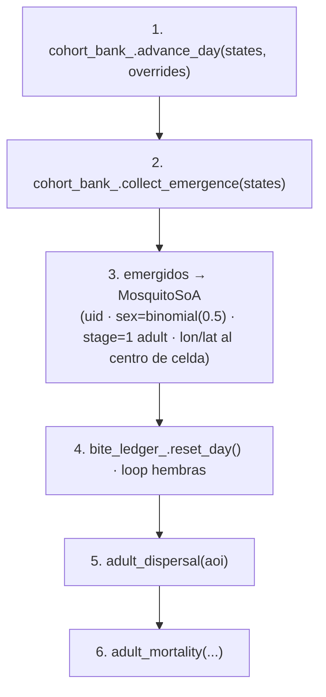
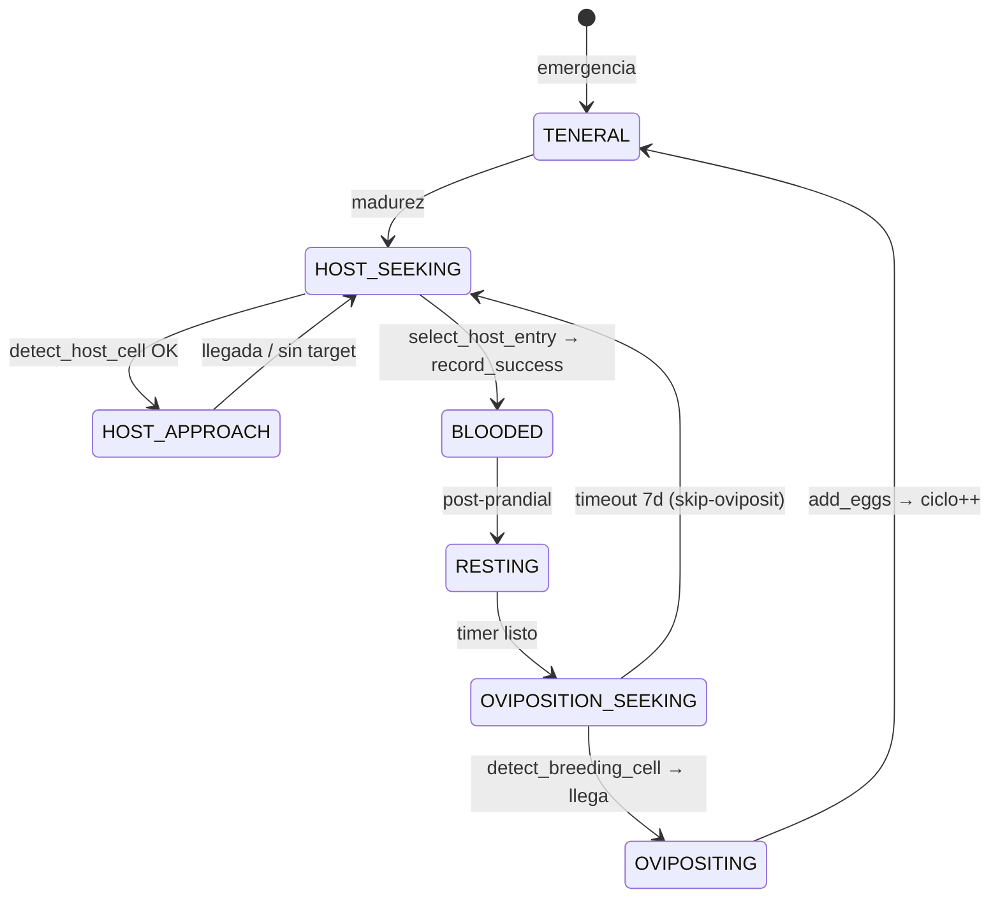

up:: [[21-engine]]

<!-- bc:auto:start -->
```breadcrumbs
type: mermaid
fields: [calls, called_by, owns]
depth: 1
mermaid-direction: LR
show-attributes: true
```

> [!info] Conexiones exactas del grafo
> **Nodo actual · nota: 23 mosquito submodel**
> *Mantenida manualmente — fuente: cpp real + índice codebase (“no es suposición”).*
| método llamador | llamada → destino | en archivo | detalle / firma |
|---|---|---|---|
| `advance_day` | `cohort_bank_.advance_day` | aquatic_cohort_bank.cpp | desarrollo + mortalidad acuática |
| `advance_day` | `collect_emergence` | aquatic_cohort_bank.cpp | `EmergenceEvent` → adultos SoA |
| `advance_day` | `bite_ledger_.reset_day` | bite_ledger.hpp | reset diario de picaduras |
| `advance_day` | `advance_gonotrophic_one_day` | gonotrophic_cycle.hpp | transición diaria de estado |
| `advance_day` | `host_seeking_->detect_host_cell` | host_seeking.cpp | target para HOST_APPROACH (radio 2km) |
| `advance_day` | `host_seeking_->approach_vector` | host_seeking.cpp | paso dirigido 50 m hacia host |
| `advance_day` | `oviposition_seeking_->detect_breeding_cell` | oviposition_seeking.cpp | target para OVIPOSITION_SEEKING |
| `advance_day` | `oviposition_seeking_->step_toward` | oviposition_seeking.cpp | paso dirigido hacia charco |
| `advance_day` | `update_patch_id` | self | ro Col só a patch_id cercano activo |
| `advance_day` | `cohort_bank_.add_eggs` | aquatic_cohort_bank.cpp | post-feeding oviposición |
| `advance_day` | `make_effective` | host_landscape.cpp | marca celdas efectivas antes del feed |
| `advance_day` | `record_attempt/record_success/record_infectious_success` | bite_ledger.hpp | stats de picadura para transmission |
| `adult_dispersal` | `wind_field_->is_migration_season` | wind_field.cpp | ventana estacional M7.6 |
| `adult_dispersal` | `uniform_double` | prng.cpp | re-sorteo de desplazamiento |
| `adult_mortality` | `uniform_double` | prng.cpp | sobrevive vs p_morir |
| `density_by_patch` | conteo SoA | local | lecturas `patch_id` |
| `adult_density_by_cell` | `cells_per_side` | wire.hpp | límites grilla |
| ctor | `seed_stage` | aquatic_cohort_bank.cpp | siembra de cohortes iniciales |

<!-- bc:auto:end -->


# 23 · MosquitoSubmodel — el corazón biológico

**Rol.** Dueño de los agentes mosquito: estado SoA (`MosquitoSoA`), banco acuático (`AquaticCohortBank`) y ledger de picaduras (`BiteLedger`). Cada dia ejecuta los estados de hembra (G4 gonotrófico) y de adultos (G3), la dispersión y mortalidad.

## Las 5 fases de `advance_day()` (cpp:466+)



### Loop hembras — máquina de estados *GonotrophicState*



*Thirst: HOST_SEEKING ≥ HOST_SEEKING_STARVATION_DAYS → muere de hambre (swap_with_last, cpp:586). OVIPOSITION_SEEKING ≥ OVIPOSITION_SEEKING_TIMEOUT_DAYS → skip y vuelve a HOST_SEEKING.*

## Desglose por región del cpp

| Líneas | Bloque | Llamados |
|---|---|---|
| 466-523 | emergencia acuática | `cohort_bank_.advance_day` → `collect_emergence` → push SoA |
| 525-870 | ciclo gonotrófico (G4) | `advance_gonotrophic_one_day` · `bite_ledger_.reset_day/record_*` |
| 547-580 | HOST_APPROACH (Plan D) | `host_seeking_->detect_host_cell` · `approach_vector` |
| 593-660 | OVIPOSITION_SEEKING | `oviposition_seeking_->detect_breeding_cell` · `step_toward` |
| 662-720 | OVIPOSITING | `update_patch_id` · `cohort_bank_.add_eggs` |
| 730-860 | HOST_SEEKING feed | `host_seeking_->select_host_entry` · `record_attempt/success` · `record_infectious_success` |
| 873-916 | `update_patch_id` | re-mapea row/col local → patch por cercanía |
| 917-1010 | `adult_dispersal(aoi)` | kernel gaussiano σ=450m + `wind_field_->is_migration_season` advectiva M7.6 |
| 1011-1078 | `adult_mortality(...)` | `uniform_double` vs survival Lardeux |
| 1079-1111 | `density_by_patch()` | conteo por parche para Coordinator |
| 1112+ | `adult_density_by_cell(aoi)` | adultos por celda (H,W) → suitability_grid |

## Estados SoA nuevos (emergencia, cpp:484-522)

`uid · patch_id · row/col · stage=1 · sex(0/1) · lon/lat · development_progress=0 · parasite_eip_progress=0 · gonotrophic_state=TENERAL · species_id · vector_state=SUSCEPTIBLE`

## Conexiones

| Desde (método) | Llama a | En | Detalle |
|---|---|---|---|
| `advance_day` | `cohort_bank_.advance_day` | aquatic_cohort_bank.cpp | desarrollo + mortalidad acuática |
| `advance_day` | `collect_emergence` | aquatic_cohort_bank.cpp | `EmergenceEvent` → adultos SoA |
| `advance_day` | `bite_ledger_.reset_day` | bite_ledger.hpp | reset diario de picaduras |
| `advance_day` | `advance_gonotrophic_one_day` | gonotrophic_cycle.hpp | transición diaria de estado |
| `advance_day` | `host_seeking_->detect_host_cell` | host_seeking.cpp | target para HOST_APPROACH (radio 2km) |
| `advance_day` | `host_seeking_->approach_vector` | host_seeking.cpp | paso dirigido 50 m hacia host |
| `advance_day` | `oviposition_seeking_->detect_breeding_cell` | oviposition_seeking.cpp | target para OVIPOSITION_SEEKING |
| `advance_day` | `oviposition_seeking_->step_toward` | oviposition_seeking.cpp | paso dirigido hacia charco |
| `advance_day` | `update_patch_id` | self | ro Col só a patch_id cercano activo |
| `advance_day` | `cohort_bank_.add_eggs` | aquatic_cohort_bank.cpp | post-feeding oviposición |
| `advance_day` | `make_effective` | host_landscape.cpp | marca celdas efectivas antes del feed |
| `advance_day` | `record_attempt/record_success/record_infectious_success` | bite_ledger.hpp | stats de picadura para transmission |
| `adult_dispersal` | `wind_field_->is_migration_season` | wind_field.cpp | ventana estacional M7.6 |
| `adult_dispersal` | `uniform_double` | prng.cpp | re-sorteo de desplazamiento |
| `adult_mortality` | `uniform_double` | prng.cpp | sobrevive vs p_morir |
| `density_by_patch` | conteo SoA | local | lecturas `patch_id` |
| `adult_density_by_cell` | `cells_per_side` | wire.hpp | límites grilla |
| ctor | `seed_stage` | aquatic_cohort_bank.cpp | siembra de cohortes iniciales |

up:: [[21-engine]] · related:: [[24-aquatic-cohort-bank]] · [[25-host-seeking]] · [[26-oviposition-seeking]] · [[28-wind-field]]