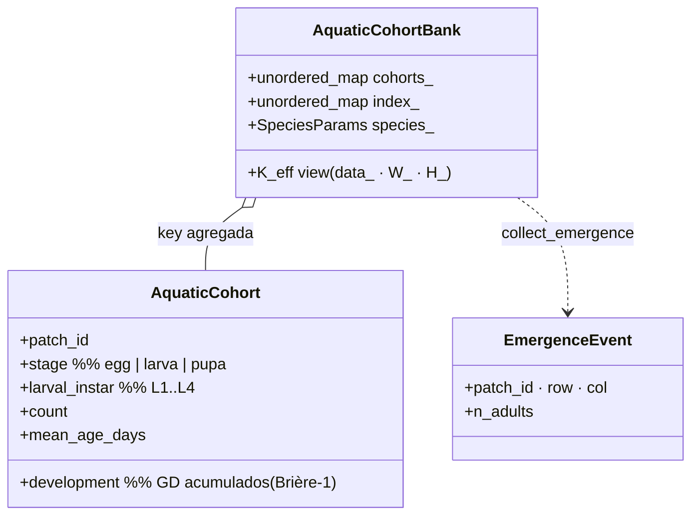
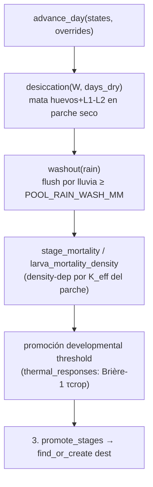

up:: [[23-mosquito-submodel]]

<!-- bc:auto:start -->
```breadcrumbs
type: mermaid
fields: [calls, called_by, owns]
depth: 1
mermaid-direction: LR
show-attributes: true
```

> [!info] Conexiones exactas del grafo
> **Nodo actual · nota: 24 aquatic cohort bank**
> *Mantenida manualmente — fuente: cpp real + índice codebase (“no es suposición”).*
| método llamador | llamada → destino | en archivo | detalle / firma |
|---|---|---|---|
| `advance_day` | `desiccation` · `washout` · `stage_mortality` · `larva_mortality_density` | aquatic_cohort_bank.cpp | mortalidad por agua + densidad |
| `advance_day` | `promote_stages` | aquatic_cohort_bank.cpp | l1→l2→…→pupa adult |
| `larva_mortality_density` | `patch_to_cell` | aquatic_cohort_bank.cpp | parche → celda para K_eff |
| `add_eggs` / `seed_stage` / `promote_stages` | `find_or_create` | aquatic_cohort_bank.cpp | clave `(patch,stage,instar)` |
| `compact` | `rebuild_index` | aquatic_cohort_bank.cpp | storage limpio tras purga |
| `write_diagnostics` | `count_by_stage[_instar]` · `total_aquatic` | aquatic_cohort_bank.cpp | para Engine::snapshot |

<!-- bc:auto:end -->


# 24 · AquaticCohortBank — inundación→emergencia

**Rol.** Todos los estadios acuáticos de un parche viven aquí como **cohortes** (agregados por parche×estado×edad), no individuos. Compresión de estado enorme: 1 cohorte = N mosquitos idénticos.

## Estructura



## Ciclo diario



## API pública

| Método | Firma | Uso |
|---|---|---|
| `advance_day` | `(states, overrides)` | llamado por submodelo fase 1 |
| `collect_emergence` | `(states) → vector<EmergenceEvent>` | fase 2: pupas alcanzaron → adultos |
| `add_eggs` | `(patch_id, row, col, n, ...)` | post-feed oviposición |
| `seed_stage` | `(patch_id, stage, instar, n, dev)` | ctor con SeedInstructions y uniform |
| `set_species` / `species()` | params por especie | fecundidad/gestación |
| `set_K_eff_view` / `K_eff_data/W/H` | vista cruda de K efectivo | coordinator conecta su grilla |
| `count_by_stage[_instar]` / `total_aquatic` | diagnósticos, snapshot | `write_diagnostics` |
| `compact()` / `rebuild_index()` | manejo del hash | internos |

## Conexiones

| Desde (método) | Llama a | En | Detalle |
|---|---|---|---|
| `advance_day` | `desiccation` · `washout` · `stage_mortality` · `larva_mortality_density` | aquatic_cohort_bank.cpp | mortalidad por agua + densidad |
| `advance_day` | `promote_stages` | aquatic_cohort_bank.cpp | l1→l2→…→pupa adult |
| `larva_mortality_density` | `patch_to_cell` | aquatic_cohort_bank.cpp | parche → celda para K_eff |
| `add_eggs` / `seed_stage` / `promote_stages` | `find_or_create` | aquatic_cohort_bank.cpp | clave `(patch,stage,instar)` |
| `compact` | `rebuild_index` | aquatic_cohort_bank.cpp | storage limpio tras purga |
| `write_diagnostics` | `count_by_stage[_instar]` · `total_aquatic` | aquatic_cohort_bank.cpp | para Engine::snapshot |

up:: [[23-mosquito-submodel]] · related:: [[31-constantes]] · [[22-coordinator]]