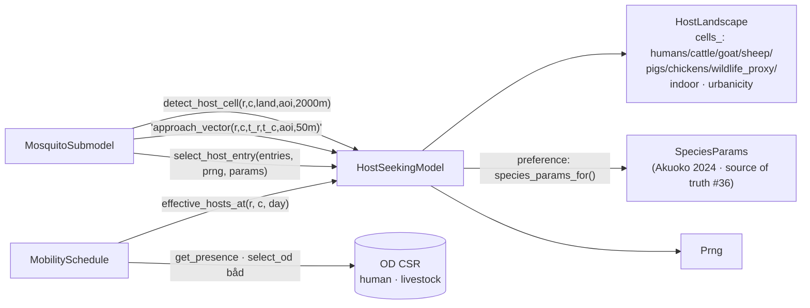

up:: [[23-mosquito-submodel]]

<!-- bc:auto:start -->
```breadcrumbs
type: mermaid
fields: [calls, called_by]
depth: 1
mermaid-direction: LR
show-attributes: true
```

> [!info] Conexiones exactas del grafo
> **Nodo actual · nota: 25 host seeking**
> *Mantenida manualmente — fuente: cpp real + índice codebase (“no es suposición”).*
| método llamador | llamada → destino | en archivo | detalle / firma |
|---|---|---|---|
| `detect_host_cell` (sub) | `HostSeekingModel::detect_host_cell` | host_seeking.cpp | radio 2000 m, punto más atractivo |
| `approach_vector` (sub) | `approach_vector` · **520 m/h** | host_seeking.cpp | vector unitario × paso |
| `select_host` (feed) | `select_host_entry` | host_seeking.cpp | sorteo ponderado: pref × densidad |
| `select_host_entry` | `uniform_double` | prng.cpp | ruleta |
| `step_toward_host` | `approach_vector` · `detect_host_cell` | host_seeking.cpp | helper dirigido |
| `EffectiveHostLandscape` | `sample_effective_hosts` → `binomial`/`uniform_double`/`peek_state` | prng.cpp | binomio (presencia diaria no determinista) |
| `effective_hosts_at` | `select_od` · `destinations` | mobility_schedule.hpp | residencia → destino del día |
| `load_from_directory` | `load_human_od` · `load_livestock_od` | mobility_schedule.hpp | carga CSR de archivos OD |
| `SparseOD` ctor | `validate` | mobility_schedule.hpp | invariantes CSR |
| `set_livestock_od` | `identity` | mobility_schedule.hpp | fallback sin OD ganado |
| `phase_active` | daily gate per hour | host_seeking.hpp | activo en horas de vuelo |

<!-- bc:auto:end -->


# 25 · HostSeekingModel + MobilitySchedule + HostLandscape

**Rol.** La pluma de olfato: decide *a qué celda va una hembra con hambre* y *a quién pica*, dada la densidad efectiva de humanos/ganado/vida silvestre y la preferencia de especie.

## Composición



## Componentes

| Clase | Header | Responsable de |
|---|---|---|
| `HostSeekingModel` | host_seeking.hpp | kernel de atracción exponencial esc `scale_m_` (~450 m Costantini); `preference()` → `HostPreference{human,cattle,goat,sheep,wildlife}` |
| `MobilitySchedule` | mobility_schedule.hpp | OD diario: `load_from_csr → SparseOD`, `get_presence(cell, day)` = residentes + visitantes; `effective_hosts_at` |
| `HostLandscape` (`HostCell`) | host_landscape.hpp | densidades + fracción indoor edificada por celda |
| `HostAttraction` | host_seeking.hpp | resultado de un scan: `{distance, attraction, primary_host, row, col}` |

## Conexiones

| Desde (método) | Llama a | En | Detalle |
|---|---|---|---|
| `detect_host_cell` (sub) | `HostSeekingModel::detect_host_cell` | host_seeking.cpp | radio 2000 m, punto más atractivo |
| `approach_vector` (sub) | `approach_vector` · **520 m/h** | host_seeking.cpp | vector unitario × paso |
| `select_host` (feed) | `select_host_entry` | host_seeking.cpp | sorteo ponderado: pref × densidad |
| `select_host_entry` | `uniform_double` | prng.cpp | ruleta |
| `step_toward_host` | `approach_vector` · `detect_host_cell` | host_seeking.cpp | helper dirigido |
| `EffectiveHostLandscape` | `sample_effective_hosts` → `binomial`/`uniform_double`/`peek_state` | prng.cpp | binomio (presencia diaria no determinista) |
| `effective_hosts_at` | `select_od` · `destinations` | mobility_schedule.hpp | residencia → destino del día |
| `load_from_directory` | `load_human_od` · `load_livestock_od` | mobility_schedule.hpp | carga CSR de archivos OD |
| `SparseOD` ctor | `validate` | mobility_schedule.hpp | invariantes CSR |
| `set_livestock_od` | `identity` | mobility_schedule.hpp | fallback sin OD ganado |
| `phase_active` | daily gate per hour | host_seeking.hpp | activo en horas de vuelo |

## Regla de oro (#36)

La preferencia de huésped vive en `species_params_for()` (species_params.cpp, valores Akuoko 2024) — única fuente de verdad; los `HostPrefWeights` de seeding config son inertes (0) para no duplicar. El **host-weighted seeding** reutiliza esta misma fórmula de atracción (`hosts × pref × decay`) para que la siembra reparta espacialmente como la actividad de picadura.

up:: [[23-mosquito-submodel]] · related:: [[28-wind-field]] · [[31-constantes]]