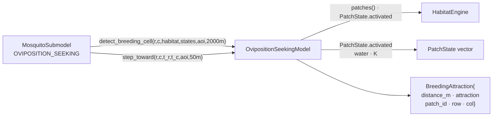

up:: [[23-mosquito-submodel]]

<!-- bc:auto:start -->
```breadcrumbs
type: mermaid
fields: [calls, called_by]
depth: 1
mermaid-direction: LR
show-attributes: true
```

> [!info] Conexiones exactas del grafo
> **Nodo actual · nota: 26 oviposition seeking**
> *Mantenida manualmente — fuente: cpp real + índice codebase (“no es suposición”).*
| método llamador | llamada → destino | en archivo | detalle / firma |
|---|---|---|---|
| sub → OVIPOSITION_SEEKING | `detect_breeding_cell` | oviposition_seeking.cpp | escaneo charcos activos |
| sub | `step_toward` | oviposition_seeking.cpp | paso hacia target |
| llegada | `PatchState.activated` | coordinator cached | si fly llega → OVIPOSITING |
| OVIPOSITING | `update_patch_id` (sub) + `cohort_bank_.add_eggs` | [[24-aquatic-cohort-bank]] | post-llegada |

<!-- bc:auto:end -->


# 26 · OvipositionSeekingModel — regreso al agua

**Rol.** Después de la comida de sangre, la hembra necesita un parche **activo** para ovipositar. Este modelo dirige el vuelo hacia el criadero más atractivo dentro del radio; sin modelo (fallback), se usa la celda actual si está activa.

## Composición



## API y semántica

| Método | Firma ~ | Detalle |
|---|---|---|
| `detect_breeding_cell` | `(row, col, habitat, patch_states, aoi, radius_m) → optional<pair<r,c>>` | solo parches `activated=true`; pondera por proximidad (decae con `scale_m_`) |
| `step_toward` | `(row, col, t_row, t_col, aoi, step_m) → {r,c}` | paso dirigido de 50 m |
| fallback (en submodelo) | binary check `ps.row==r && ps.col==c && ps.activated` | sin modelo dirigido |
| timeout | `OVIPOSITION_SEEKING_TIMEOUT_DAYS` (7) | skip-oviposit → vuelve a HOST_SEEKING [[31-constantes]] |

## Conexiones

| Desde (método) | Llama a | En | Detalle |
|---|---|---|---|
| sub → OVIPOSITION_SEEKING | `detect_breeding_cell` | oviposition_seeking.cpp | escaneo charcos activos |
| sub | `step_toward` | oviposition_seeking.cpp | paso hacia target |
| llegada | `PatchState.activated` | coordinator cached | si fly llega → OVIPOSITING |
| OVIPOSITING | `update_patch_id` (sub) + `cohort_bank_.add_eggs` | [[24-aquatic-cohort-bank]] | post-llegada |

## Diferencia con host_seeking

- HostSeeking busca *densidad de huéspedes* (atracción biológica `pref × densidad × e^-d/σ`.
- OvipositionSeeking busca **parches con agua** (`activated=true`) — atraida por proximidad, no por huéspedes.
- Ambos comparten patrón: detect → step 50 m → check llegada.

up:: [[23-mosquito-submodel]] · related:: [[22-coordinator]] · [[24-aquatic-cohort-bank]]