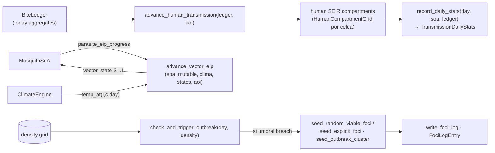

up:: [[21-engine]]

<!-- bc:auto:start -->
```breadcrumbs
type: mermaid
depth: [0, 1]
sort: field
show-attributes: [field]
mermaid-direction: LR
mermaid-arrow: true
```

> [!info] Conexiones exactas del grafo
> **Nodo actual · nota: 27 transmission**
> *Mantenida manualmente — fuente: cpp real + índice codebase (“no es suposición”).*
| método llamador | llamada → destino | en archivo | detalle / firma |
|---|---|---|---|
| `init` | `Prng` ctor | prng.cpp | RNG separado, reproducibilidad |
| `seed_vector_infections` | `uniform_double` | prng.cpp | sorteos de vector infectado |
| `seed_human_infections` | `seed_infections` | human_state.cpp | rango compartimento → I |
| `check_and_trigger_outbreak` | `compute_stats` · `population` · `infectious` | human_state.cpp/hpp | estado del grid humano |
| `check_and_trigger_outbreak` | `seed_outbreak_cluster` · `seed_random_viable_foci` · `seed_explicit_foci` | transmission.cpp/human_state.cpp | semillas de foco |
| `seed_random_viable_foci` | `uniform_double` · `total_cells` | prng/human_state | celda aleatoria viable |
| `advance_vector_eip` | `temp_at` | climate.cpp | temperatura a día/celda |
| `advance_human_transmission` | `today` (BiteLedger) · `population` | bite_ledger.hpp · human_state.hpp | incidencias del día |
| `record_daily_stats` | `compute_stats` · `today` | human_state.cpp · bite_ledger.hpp | stats snapshoteadas |

<!-- bc:auto:end -->


# 27 · TransmissionModel — la cadena del patógeno

**Rol.** Puente mosquito↔humano: consume el `BiteLedger` (qué picadas ocurrieron hoy y en cuál celda), avanza la EIP del vector infectado con GDD del clima, y hace seguir el compartimento humano (S→E→I→) por celda.

## Flujo



## Métodos

| Método | Qué hace | Consumidor |
|---|---|---|
| `init(...)` | crea `Prng` dedicado, resetea compartimentos | ctor Engine |
| `seed_vector_infections(n)` | infecta n vectores uniforme | foci/CTOR |
| `seed_human_infections(...)` | `seed_infections()` en human_state | foci/ctor |
| `check_and_trigger_outbreak(day, density)` | si densidad ≥ umbral y no hay outbreak: `compute_stats` → `population()` → `seed_outbreak_cluster` / `seed_random_viable_foci` / `seed_explicit_foci` → `infectious()` | Engine::step paso 7 |
| `advance_vector_eip` | EIP(GDD) por vector, `temp_at` del climate | Engine::step paso 8 |
| `advance_human_transmission` | picaduras hoy → infección humana → SEIR celdas | Engine::step paso 9 |
| `record_daily_stats` | snapshots + `compute_stats` + EIR | Engine::step paso 10 |
| `write_foci_log(path)` | `FociLogEntry` JSON | Engine::step (post-brote) |
| `outbreak_triggered()` / `is_enabled()` | estado | gate Engine |

## Conexiones

| Desde (método) | Llama a | En | Detalle |
|---|---|---|---|
| `init` | `Prng` ctor | prng.cpp | RNG separado, reproducibilidad |
| `seed_vector_infections` | `uniform_double` | prng.cpp | sorteos de vector infectado |
| `seed_human_infections` | `seed_infections` | human_state.cpp | rango compartimento → I |
| `check_and_trigger_outbreak` | `compute_stats` · `population` · `infectious` | human_state.cpp/hpp | estado del grid humano |
| `check_and_trigger_outbreak` | `seed_outbreak_cluster` · `seed_random_viable_foci` · `seed_explicit_foci` | transmission.cpp/human_state.cpp | semillas de foco |
| `seed_random_viable_foci` | `uniform_double` · `total_cells` | prng/human_state | celda aleatoria viable |
| `advance_vector_eip` | `temp_at` | climate.cpp | temperatura a día/celda |
| `advance_human_transmission` | `today` (BiteLedger) · `population` | bite_ledger.hpp · human_state.hpp | incidencias del día |
| `record_daily_stats` | `compute_stats` · `today` | human_state.cpp · bite_ledger.hpp | stats snapshoteadas |

## Nota de diseño

Los mosquitos **no propagan** directamente el parásito al humano: la evidencia vive dentro de `BiteLedger` (`record_infectious_success`); transmission no conoce la biología del mosquito, solo picadas y su `vector_state`. Ignorancia recíproca: `MosquitoSubmodel` no ve el SEIR humano, sólo expone `human_grid_` como const view.

up:: [[21-engine]] · related:: [[23-mosquito-submodel]] · [[15-bucle-diario]]