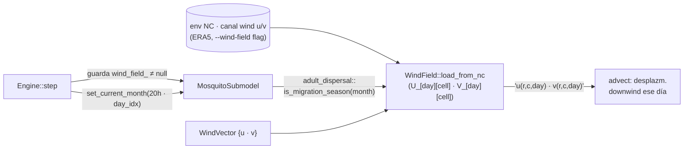

up:: [[23-mosquito-submodel]]

<!-- bc:auto:start -->
```breadcrumbs
type: mermaid
fields: [calls, called_by]
depth: 1
mermaid-direction: LR
show-attributes: true
```

> [!info] Conexiones exactas del grafo
> **Nodo actual · nota: 28 wind field**
> *Mantenida manualmente — fuente: cpp real + índice codebase (“no es suposición”).*
| método llamador | llamada → destino | en archivo | detalle / firma |
|---|---|---|---|
| `adult_dispersal` (sub) | `is_migration_season(current_month_)` | wind_field.cpp | gate estacional |
| `adult_dispersal` (sub) | `u/v @ (row,col,day)` | wind_field.cpp | advectiva + dispersal normal si no temporada |
| `Engine::step` | `set_current_month/hour/day_index` | mosquito_submodel.hpp | prepara contexto antes de advance_day |

<!-- bc:auto:end -->


# 28 · WindField — migración del viento

**Rol.** Campo diario de viento (u,v por celda, opcional). En la ventana estacional activa, una fracción de adultos en dispersión se deja advectar por el viento en vez de moverse con kernel gaussiano.

## Entradas / salidas



## API

| Miembro | Firma | Detalle |
|---|---|---|
| struct `WindVector` | `{u, v}` | componentes del viento |
| `WindField` | clase dueña de series diarias | `load_from_nc(path_or_grid)` |
| `is_migration_season(month)` | `bool` | ventana estacional (mes del año) |
| `u/v at (row,col,day)` | interpolación diaria | componente para advect |

## Conexiones

| Desde (método) | Llama a | En | Detalle |
|---|---|---|---|
| `adult_dispersal` (sub) | `is_migration_season(current_month_)` | wind_field.cpp | gate estacional |
| `adult_dispersal` (sub) | `u/v @ (row,col,day)` | wind_field.cpp | advectiva + dispersal normal si no temporada |
| `Engine::step` | `set_current_month/hour/day_index` | mosquito_submodel.hpp | prepara contexto antes de advance_day |

## Notas

- **Sin** `--wind-field`, el puntero `wind_field_` es null → guard del Engine no ejecuta set_current_* y dispersal cae al kernel gaussiano puro. Migración eólica es **opt-in** (data era5 "wind" opcionalmente resuelta por Slot).
- El `--wind-field` llega ya resuelto por el runner Python vía catalog Slot `"wind"` (manifest-key). Véase [[40-wrapper]].

up:: [[23-mosquito-submodel]] · related:: [[31-constantes]] · [[40-wrapper]]