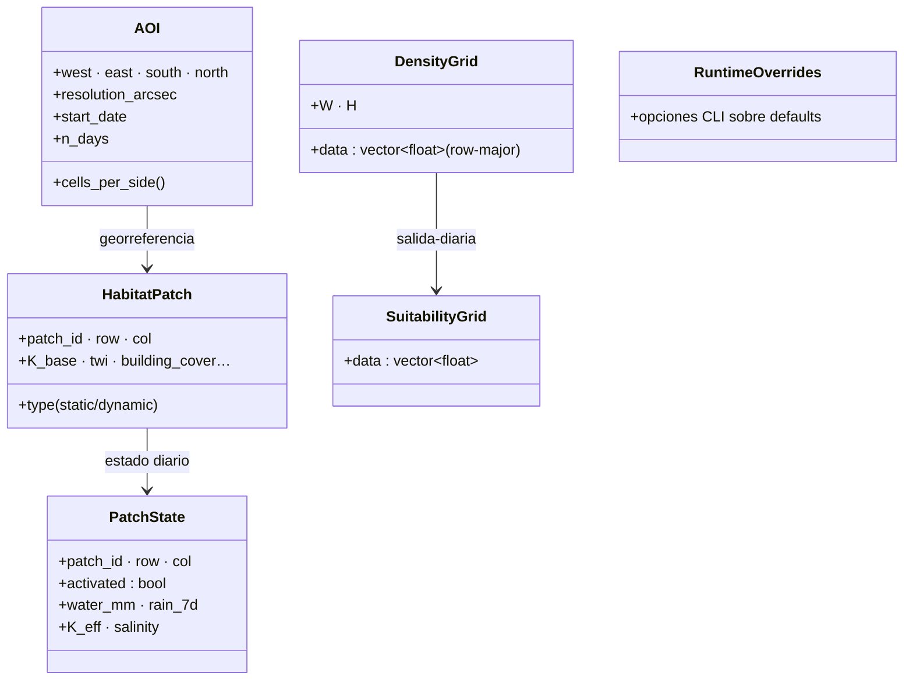

up:: [[00-INDEX]]

# 30 · `wire.hpp` — el contrato de datos

**Rol.** Header que **todos** incluyen: define las estructuras que cruzan fronteras entre módulos y las constantes que cruzan la frontera Python→C++. Si cambias aquí, cambio en cascada garantizado.

## Tipos

| Tipo | Archivo origen | Consumido por |
|---|---|---|
| `AOI` | wire.hpp (ctor en main.cpp) | todos; `cells_per_side()` usado por coordinator, submodel, transmission, output |
| `HabitatPatch` | habitat_engine | coordinator, oviposition |
| `PatchState` | oviposition_seeking.hpp (también definido en wire para cross) | coordinator → submodel → transmission |
| `DensityGrid` / `SuitabilityGrid` | wire.hpp | coordinator (aggregate), engine (snapshot) |
| `RuntimeOverrides` | wire.hpp | mosquit submodel, cohortbank, coordinator |

## Convención de grillas

- **row-major** float32, `(H × W)`; `H` from `cells_per_side_h(aoi)`, `W` from `cells_per_side(aoi)` ([[31-constantes]]).
- Compatibles 1:1 con GDAL raster (`float32 geotiff`), indexado `(row * W + col)`.
- Los COGs producidos (`state.tif`, `transmission.tif`) heredan el geotransform del AOI.

## Por qué un solo header

- Evita 15 headers incluyendo definiciones duplicadas.
- Todo lo que cambia una vez, cambia en todos lados (single-source-of-truth, igual que species_params).
- Encaja con el pattern: **cludge barato, costo bajo, paridad total** — mira `["31-constantes"]]` para el valor espejo Python↔C++.

## Conexiones (quién usa qué)

| Consumer | Qué usa de wire |
|---|---|
| [[22-coordinator]] | PatchState, DensityGrid, `cells_per_side` |
| [[23-mosquito-submodel]] | AOI, PatchState, K_MAX, celda↔lon/lat |
| [[24-aquatic-cohort-bank]] | PatchState (water/K), `patch_to_cell` |
| [[27-transmission]] | AOI, grids |
| [[21-engine]] | todos (arma el snapshot) |
| [[40-wrapper]] · main.cpp | AOI (bbox CLI → struct) |

up:: [[00-INDEX]] · related:: [[31-constantes]]