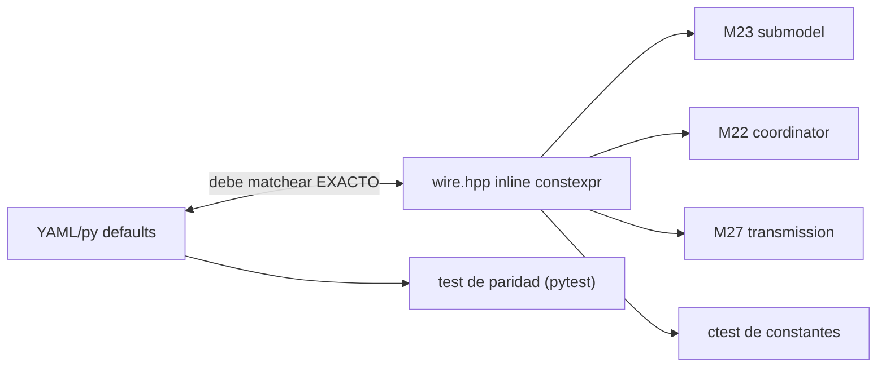

up:: [[00-INDEX]]

# 31 · Constantes — paridad Python ↔ C++

**Rol.** Valores `inline constexpr` con cita de paper en comentario. **Regla de oro**: deben matchear los defaults Python exactos (los tests lo verifican).

## Catalogo

| Constante | Valor | Fuente | Usada en |
|---|---|---|---|
| `K_MAX` | max larvas por celda-cap | coherencia con coordinator aggregate + divergence cap | [[22-coordinator]] [[23-mosquito-submodel]] |
| `EIP_THRESHOLD_GD` | 110 growing-degree-days (base 16°C) | EIP modelo GDD | [[27-transmission]] · ctor detection seeding (adultos listos día 1) |
| dispersal σ | 450 m | Costantini 1996 | [[23-mosquito-submodel]] adult_dispersal · [[25-host-seeking]] scale_m_ |
| mortalidad Lardeux | basal 0.93/day σ=15 | Lardeux 2008 | adult_mortality · thermal_responses (lardeux_p_d) |
| fecundidad | 0.25 ratio | Akuoko 2024 | [[24-aquatic-cohort-bank]] add_eggs |
| `HOST_SEEKING_STARVATION_DAYS` | 7 | Plan D thirst | submodelo (mata hambre) |
| `OVIPOSITION_SEEKING_TIMEOUT_DAYS` | 7 | Plan D skip | [[26-oviposition-seeking]] |
| `POOL_WATER_BREED_MM` | umbral W activo | M14 pool_hydrology | [[22-coordinator]] activate_patches |
| `POOL_WATER_DRY_MM` | umbral seco → desiccation | M14 | cohort bank |
| `POOL_RAIN_WASH_MM` | washout flush | M14 | cohort bank washout |
| `URBAN_B_MIN` / `URBAN_R_MIN_MM` / TWI_MIN / DENSITY_CAP | reglas urbanas de charcos | M14 | coordinator setters urban_* |
| `TWI_THRESHOLD` | 8 | regex humedales DEM | [[22-coordinator]] |
| `POOL_CATCHMENT_*` | runoff factor | Bomblies 2008 HYDREMATS | pool DailyForcing |
| `gonotrophic_days` | 2.0f (resting 0.5d) | paridad M7.4.1 (⚠️ 5 ctest legacy fallan por esto — expected) | gonotrophic_cycle |

## Regla de oro paridad

Nuca hardcodear en un cpp el valor de una de estas constantes: hay que **leer de wire.hpp**; si necesitas un valor nuevo, agrégalo a wire.hpp con cita del paper y espejo en YAML Python.

up:: [[00-INDEX]] · related:: [[30-tipos-datos]] · [[23-mosquito-submodel]]