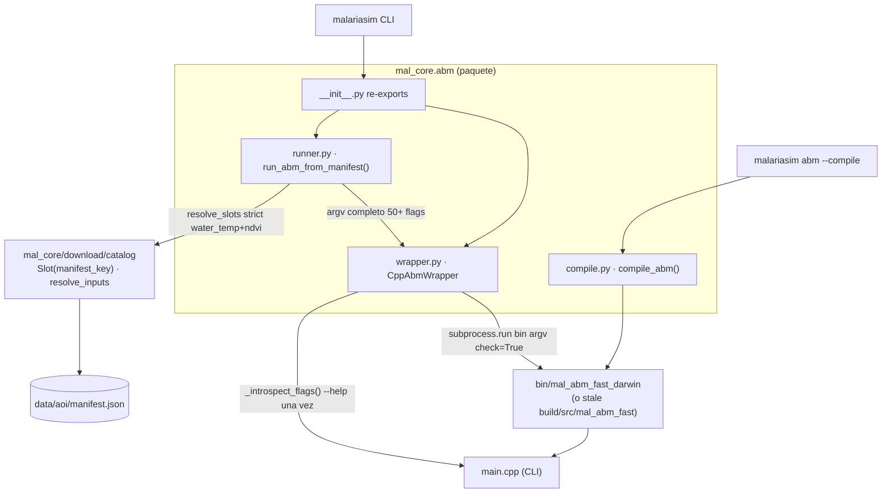

up:: [[10-sistema]]

<!-- bc:auto:start -->
```breadcrumbs
type: mermaid
fields: [calls, called_by]
depth: 1
mermaid-direction: LR
show-attributes: true
```


<!-- bc:auto:end -->


# 40 · Capa Python — wrapper, runner, compile

**Rol.** Python **nunca** simula: prepara argv, lanza el binario en subprocess y lee la salida. El único contrato son flags CLI y archivos.

## Componentes



## Métodos de `CppAbmWrapper`

| Método | Qué hace |
|---|---|
| `__init__` → `_resolve_binary()` | ruta del binario: **gana `bin/mal_abm_fast_<platform>`** sobre `build/src/mal_abm_fast` (regla #28 — tras compilar manual hay que `cp`; con `malariasim abm --compile` el copy es automático) |
| `run(...)` → `_introspect_flags()` | corre `bin --help` una vez, cachea flags, arma argv y `subprocess.run` |
| `get_flags_schema()` | introspección estática (CLI/DX) |

## `run_abm_from_manifest` (runner.py)

1. `catalog.resolve` para cada Slot (wind opcional, water_temp y ndvi **required**; era5 "wind" → `--wind-field`).
2. Añade paths reales y flags según defaults del manifest (`required_for_abm` es solo metadata de display, no gate).
3. Delega en `CppAbmWrapper.run(...)` con paths resueltos.

## Contrato con C++ ([[20-main-cli]])

| Python side | C++ side |
|---|---|
| `--aoi "W,E,S,N"` | resolve_aoi → AOI |
| `--start-date / --days` | Engine::step × days |
| `--seed` | Prng(seed + rollout_i) |
| `--n-rollouts` | loop OpenMP |
| `--output-dir / rollout prefix` | snapshot paths |
| `--transmission-*` | TransmissionParams + foci log |
| `--wind-field path.nc` | WindField (opt-in) |
| `--enable-* / --override-*` | RuntimeOverrides |

## Pitfall eterno (#28)

> `bin/mal_abm_fast_darwin` **gana** sobre `build/src/mal_abm_fast`. Compilar cmake a mano sin `cp` → Python corre binario viejo **sin error**. El CLI `malariasim abm --compile` evita esto (auto-cp).

up:: [[10-sistema]] · related:: [[20-main-cli]] · [[28-wind-field]]