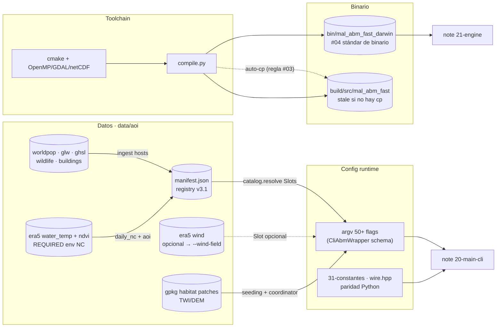

up:: [[00-INDEX]]

<!-- bc:auto:start -->
```breadcrumbs
type: mermaid
fields: [calls]
depth: 1
mermaid-direction: LR
show-attributes: true
```

> [!info] Conexiones exactas del grafo
> **Nodo actual · nota: dependency flow diagram**
> *Mantenida manualmente — fuente: cpp real + índice codebase (“no es suposición”).*
| método llamador | llamada → destino | en archivo | detalle / firma |
|---|---|---|---|
| compilar | compile.py + cmake | mal-core/abm/compile.py | auto-cp a bin/ |
| resolver datos | catalog Slots | mal-core/download/catalog.py | resolve_inputs strict |
| wrapper | `_resolve_binary()` | wrapper.py | orden bin/ > build/src |
| engine | climate NC + habitat gpkg | engine.cpp ctor | del argv CLI |
| step() | `set_climate_day`, activate | coordinator.cpp | [[15-bucle-diario]] |

<!-- bc:auto:end -->

# 12 · Flujo de dependencias — qué necesita qué para correr

**Rol.** Sinopsis de *dependencias*, no de llamadas: qué artefactos (binario, datos, datasets, flags) exige cada etapa y quién los produce. Complementa [[10-sistema]] (capas) y [[15-bucle-diario]] (ejecución diaria).

## Grafo de dependencias



## Tabla de dependencias por etapa

| Etapa | Depende de | Producido por | Si falta |
|---|---|---|---|
| compilar | toolchain cmake + librerías | `malariasim abm --compile` | no hay binario → wrapper falla al resolver |
| resolver datos | manifest.json + datasets descargados | `malariasim download --aoi` + `ingest` | `catalog.resolve` lanza error (strict en water_temp/ndvi) |
| resolver clima | era5 `water_temp` + `ndvi` **required**; `wind` opcional | era5.py downloader | ingest falla si faltan los required |
| wrapper | binario correcto en `bin/` | compile auto-cp | **stale silently** (regla #04) — comportamiento viejo |
| engine | AOI (bbox CLI) + climate NC + habitat gpkg | main.cpp | throws en ctor |
| seeding | gpkg detecciones o uniform | seeding.cpp / coordinator | sin instrucciones → init default |
| transmission | constantes + BiteLedger + human grid | [[27-transmission]] + [[31-constantes]] | se omite el bloque M7.4 si `is_enabled()==false` |
| wind | era5 "wind" + mes de migración | WindField | dispersal 100% kernel gaussiano (opt-in) |
| outputs | GDAL driver COG + JSON | [[21-engine]] snapshot | main lanza error al escribir |
| flags | binario nomenclado + AOI + paths datasets | [[20-main-cli]] + [[40-wrapper]] | wrapper no arma argv → abort |

## Reglas de oro

1. **Binario siempre en `bin/`** (regla #04): `bin/mal_abm_fast_darwin` gana sobre `build/src/mal_abm_fast`. `malariasim abm --compile` hace el cp automático; cmake a mano no.
2. **Slot único** (regla data-catalog): nada hardcode; `catalog.resolve` vía `Slot(manifest_key, required, per_year)` — nunca glob de filename.
3. **Paridad de constantes**: si tocas [[31-constantes]], espejo exacto en defaults Python; los tests lo verifican.
4. `required_for_abm` del manifest es *solo display*; el gate real es `Slot.required` en `ENV_INPUT_SLOTS`.

## Conexiones

| Desde (etapa) | Depende de | En | Detalle |
|---|---|---|---|
| compilar | compile.py + cmake | mal-core/abm/compile.py | auto-cp a bin/ |
| resolver datos | catalog Slots | mal-core/download/catalog.py | resolve_inputs strict |
| wrapper | `_resolve_binary()` | wrapper.py | orden bin/ > build/src |
| engine | climate NC + habitat gpkg | engine.cpp ctor | del argv CLI |
| step() | `set_climate_day`, activate | coordinator.cpp | [[15-bucle-diario]] |

up:: [[00-INDEX]] · related:: [[10-sistema]] · [[40-wrapper]]